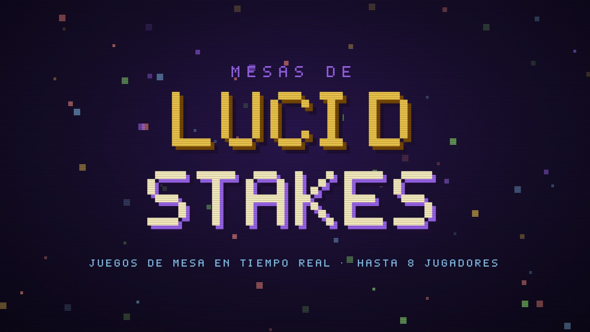
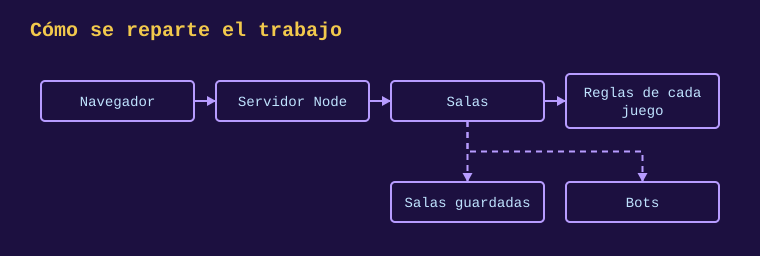
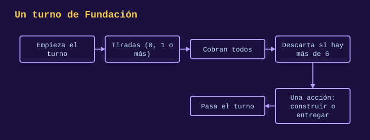
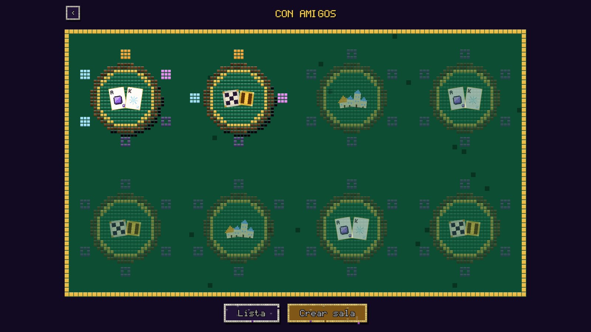
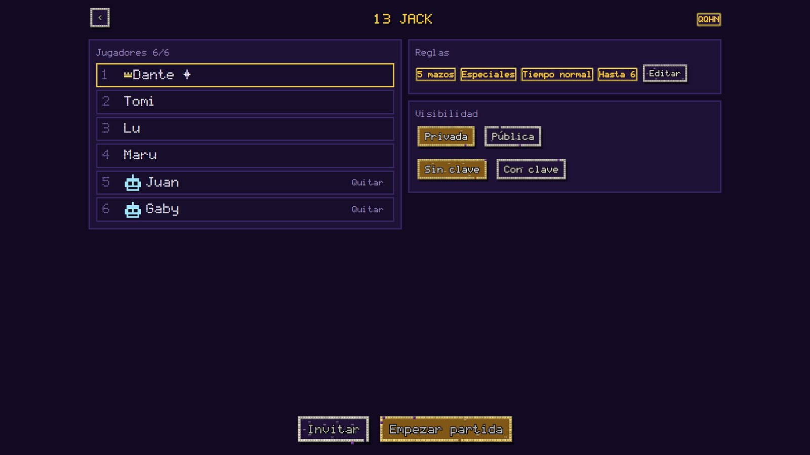
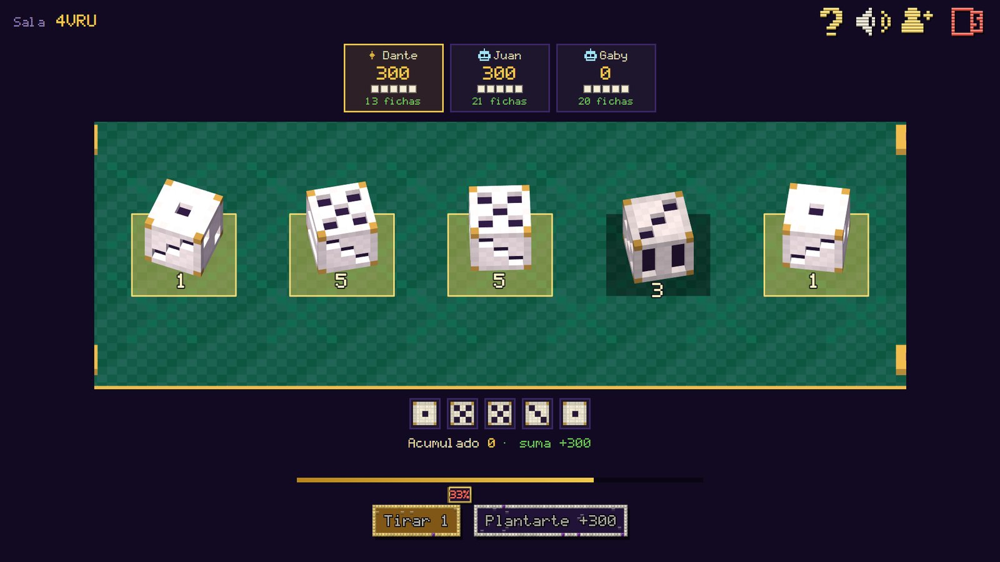
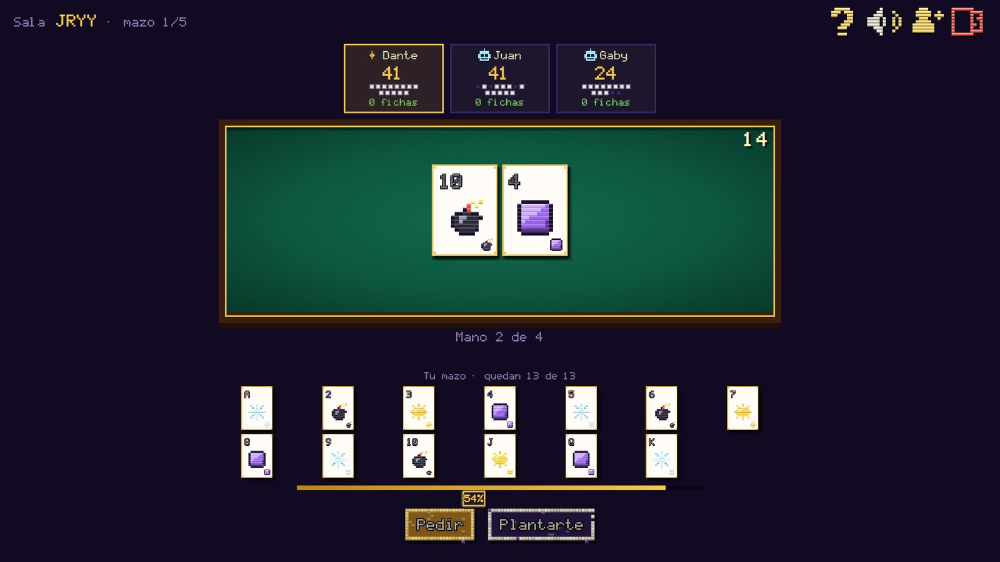
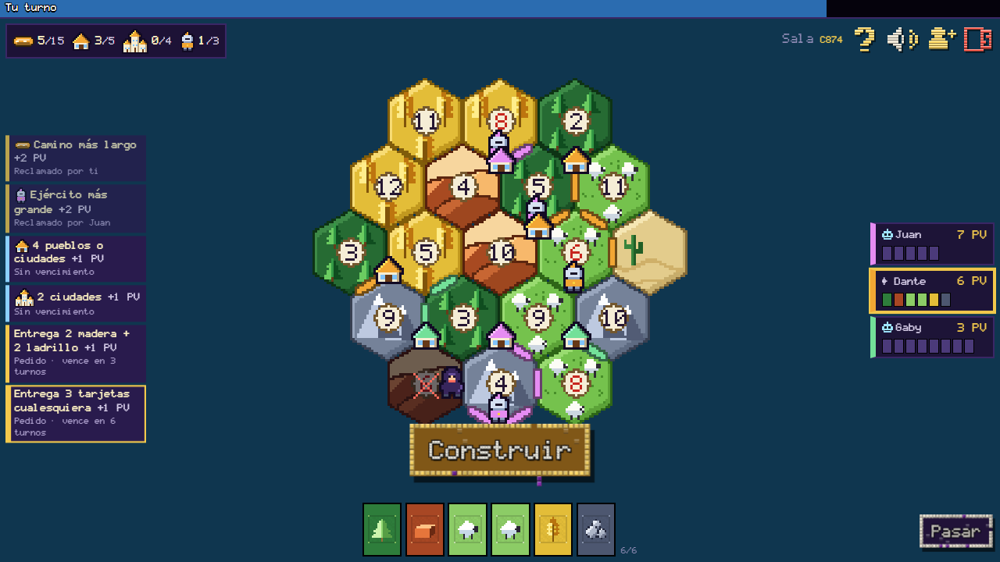

# Mesas de Lucid Stakes

Juegos de mesa para jugar en el navegador con amigos o contra bots, desde el celular o la computadora. No hay nada que instalar: abres el enlace y juegas.

[](docs/media/trailer.mp4)

**🎲 [Jugar ahora: mesas.dsinesi.com](https://mesas.dsinesi.com)** · **▶ [Ver el trailer (1 minuto)](docs/media/trailer.mp4)**

## Qué te da

- **Tres juegos propios**, para pasar un rato corto o una partida larga.
- **Partidas con amigos:** creas una sala, compartes el código de 4 letras y juegan hasta 8.
- **Partidas solo:** los bots llenan los lugares vacíos y reemplazan a quien se va.
- **Celular y computadora:** el mismo juego en las dos. Si te desconectas, vuelves a la partida donde estabas.

## Los juegos

| | |
|---|---|
| **Diez mil** · dados | Tiras los dados, apartas puntos y decides si te plantas o arriesgas todo. |
| **13 Jack** · cartas | Cada jugador tiene su propio mazo y arma manos de 21 con combos y cartas especiales. |
| **Fundación** · mapa y tarjetas | Un juego de colonización rápido: con cada tirada cobran todos, y se gasta lo ganado en construir o en cumplir pedidos. |

## Cómo funciona

<p align="center"><br><sub>El navegador envía lo que haces; el servidor aplica las reglas, guarda las salas y devuelve el estado de la mesa.</sub></p>

<p align="center"><br><sub>Cada turno de Fundación: tiradas, cobro de todos, descarte si hace falta y una sola acción.</sub></p>

Así se ven las mesas y los tres juegos (Fundación, a mitad de partida):

| Lobby con salas abiertas | Sala de espera con bots |
|---|---|
|  |  |
| **Diez mil** | **13 Jack** |
|  |  |
| **Fundación** | |
|  | |

## Cómo empezar

1. Instala [Node.js](https://nodejs.org) 18 o más nuevo (no hay nada más que instalar).
2. Arranca el servidor con `npm start`.
3. Abre `http://localhost:3000` en el navegador.

## Más información

- Índice de la documentación: [docs/INDEX.md](docs/INDEX.md)
- Estado actual: [docs/ESTADO.md](docs/ESTADO.md)
- Cómo está hecho el proyecto hoy: [docs/diseno.md](docs/diseno.md)
- Reglas y pantallas de Fundación: [reglas](docs/fundacion_reglas.md), [flujo](docs/fundacion_flujo.md) y [pantallas](docs/fundacion_v2_pantallas.md)
- Duración y balance medidos con bots: [docs/fundacion_v2_calibracion.md](docs/fundacion_v2_calibracion.md)
- Principios para diseñar juegos nuevos: [docs/principios_diseno.md](docs/principios_diseno.md)

## Para quien colabora

**Requisitos:** Node 18 o más nuevo. No tiene dependencias que instalar.

**Pruebas:** `npm test` corre las 17 suites (reglas, salas, bots, partidas completas y service worker); cada una termina en «fallos: 0».

**Carpetas:**

```
server.js          Arranque HTTP: sirve web/ y enruta /api/*
servidor/          Salas, reglas y máquinas de estado de cada juego, y los bots
web/               Cliente: pantallas, dibujo en canvas, dados 3D, sonido y service worker
datos/             Salas guardadas, se crea al jugar (no se versiona)
simulador/         Partidas solo de bots para medir duración y balance
pruebas/           Suites de pruebas
herramientas/      Scripts para empaquetar el sitio y generar los glifos
paquete/           El .zip que se sube al hosting (no se versiona)
presentacion/      Scripts para capturar pantallas y montar el trailer (todavía sin versionar)
prototipos/        Maquetas HTML de diseño y capturas de revisión
respaldos/         Copias de seguridad de las salas guardadas (no se versiona)
docs/              Documentación: requisitos, decisiones, diagramas, diseño y estado
```

**Técnica:** servidor en Node.js sin dependencias, tiempo real con long-polling (compatible con hosting compartido, sin WebSockets), cliente en HTML, JavaScript y CSS sin frameworks, arte en píxeles dibujado por código y sonido sintetizado.

Ramas por cambio, commits con Conventional Commits en español neutro y Pull Request. Detalle en la documentación.

## Autor

Diseño y desarrollo: **Dante Jorge Sinesi**.
