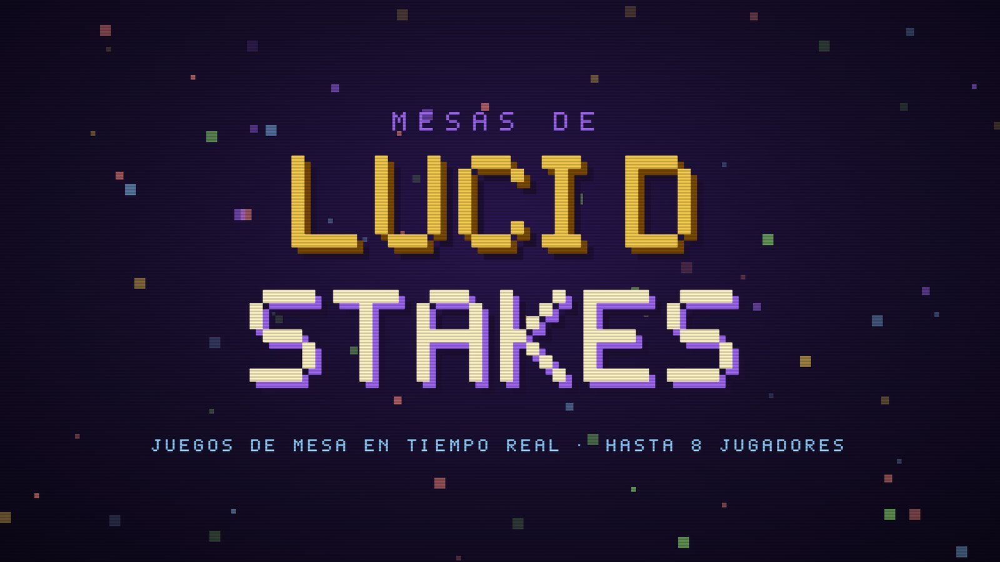
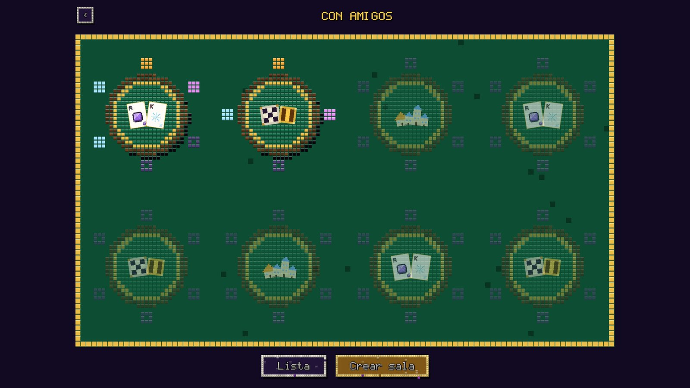
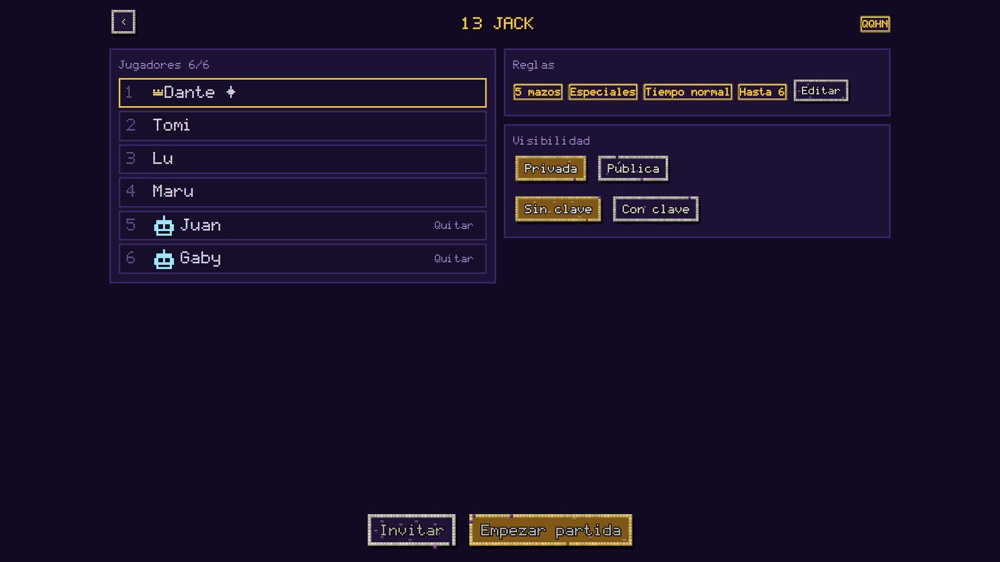
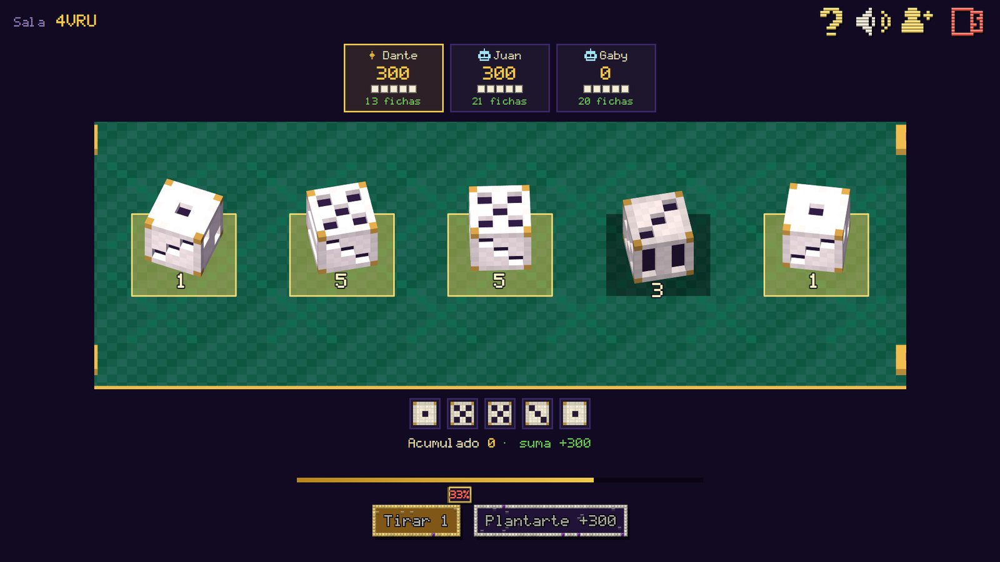
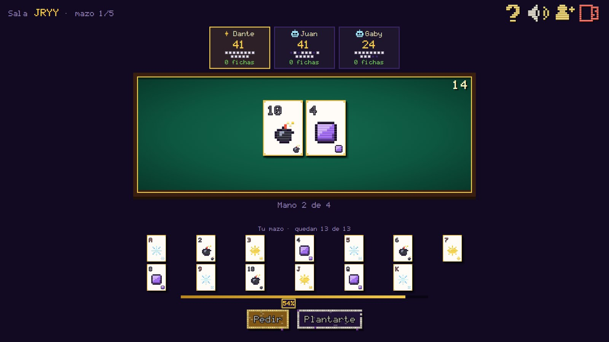
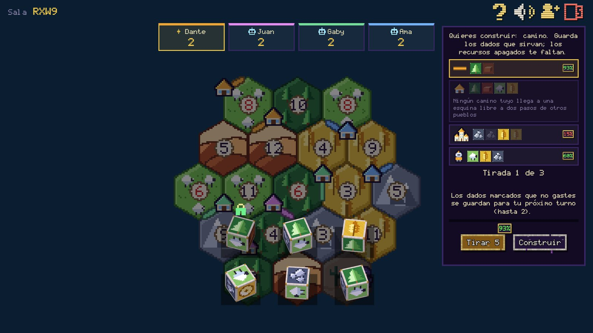
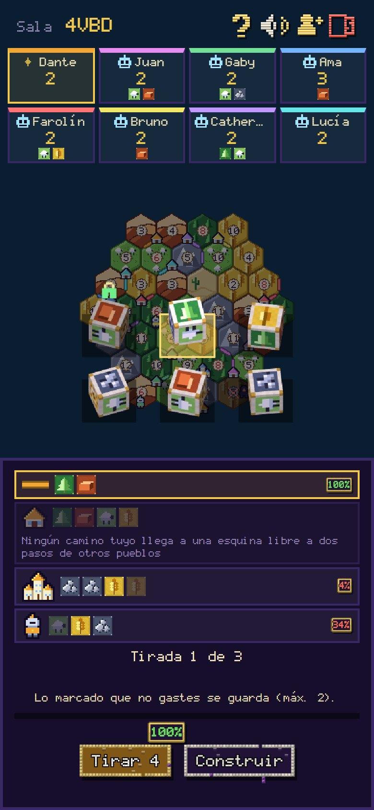

# Mesas de Lucid Stakes

Mesas de juego multijugador en tiempo real, para jugar en el navegador (celular o escritorio) con amigos o contra bots. Tres juegos propios, todo con arte en píxeles dibujado por código, dados 3D y sonido sintetizado: sin imágenes ni librerías externas.

[](docs/media/trailer.mp4)

**▶ [Ver el trailer (1 minuto)](docs/media/trailer.mp4)**

## Los juegos

| | |
|---|---|
| **Diez mil** · dados | Tiras, apartas puntos y decides si te plantas o arriesgas todo. Dados 3D, objetos, tienda de mejoras y modos con amigos, escalera y carrera. |
| **13 Jack** · cartas | Cada jugador tiene su propio mazo de 13 cartas y juega manos de 21 con patrones, combos y 19 cartas especiales. |
| **Fundación** · dados + mapa | Un Catan de dados para 1 a 8 jugadores: el mapa te da recursos, tiras dados de recursos, los guardas y construyes caminos, pueblos, ciudades y caballeros mientras el bandido te acecha. |

## Capturas

| Lobby con salas abiertas | Sala de espera con bots |
|---|---|
|  |  |
| **Diez mil** | **13 Jack** |
|  |  |
| **Fundación** (escritorio) | **Fundación** (celular, 8 jugadores) |
|  |  |

## Qué tiene por dentro

- **Servidor autoritativo en Node.js, sin dependencias** (solo módulos nativos). Las reglas viven en el servidor; el cliente solo envía acciones y dibuja lo que recibe.
- **Tiempo real con long-polling**: compatible con hosting compartido, sin WebSockets. Reconexión, recarga de página y reinicio del servidor sin perder la partida.
- **Salas con amigos**: código de 4 letras, clave opcional, mapa del lobby con mesas públicas, hasta 8 jugadores, bots que llenan las plazas y que reemplazan a quien se desconecta o no juega (con aviso y botón para retomar el control).
- **Cliente sin frameworks**: HTML + JavaScript + CSS. Todo el arte es píxel plano dibujado por código en `<canvas>`; los dados 3D son un renderizador propio de cubos; el sonido se sintetiza con WebAudio.
- **PWA instalable** con service worker versionado.
- **Diseño adaptable**: el mismo juego en celular y en escritorio, con una cámara de mapa con zoom y zonas táctiles para elegir en pantallas chicas.
- **Pruebas**: 15 suites de Node (`npm test`) que cubren reglas, salas, bots, partidas completas y el service worker.
- **Balance con datos**: simuladores de partidas solo con bots (`simulador/`) que miden la duración y dónde se traba el juego según la cantidad de jugadores; ver [`docs/fundacion_estadisticas.md`](docs/fundacion_estadisticas.md) y [`docs/fundacion_costo_ciudad.md`](docs/fundacion_costo_ciudad.md).

## Cómo probarlo

```bash
npm start          # http://localhost:3000
npm test           # todas las pruebas (cada suite termina en "fallos: 0")
```

Requiere Node 18 o superior. No hay nada que instalar.

## Estructura

```
server.js          Arranque HTTP: sirve web/ y enruta /api/*
servidor/          Salas, reglas y máquinas de estado de cada juego, y los bots
web/               Cliente: pantallas, dibujo en canvas, dados 3D, sonido, service worker
simulador/         Partidas solo de bots para medir duración y balance
pruebas/           Suites de pruebas
docs/              Diseño de los juegos, estadísticas y decisiones de balance
```

## Documentación de diseño

- [`docs/diseno.md`](docs/diseno.md): el proyecto hoy.
- [`docs/catan_dados.md`](docs/catan_dados.md) y [`docs/catan_flujo.md`](docs/catan_flujo.md): reglas y pantallas de Fundación.
- [`docs/fundacion_plan.md`](docs/fundacion_plan.md): plan de programación y decisiones.
- [`docs/principios_diseno.md`](docs/principios_diseno.md): principios para diseñar juegos nuevos.

## Autor

Diseño y desarrollo: **Dante Jorge Sinesi**.
