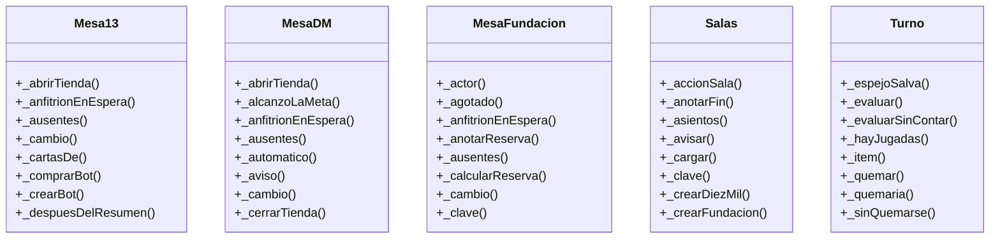

<!-- generado por documentar.py: provisorio, inferido del código. Se regenera con `documentar.py estructura --aplicar`; para editarlo a mano, borrar esta línea. -->

# Clases del módulo servidor

Clases inferidas del código del módulo `servidor` (5 en total). Evidencia: `servidor/trecejack/mesa_13.js:24`, `servidor/diezmil/mesa_dm.js:28`, `servidor/fundacion/mesa_fundacion.js:19`, `servidor/salas.js:28`, `servidor/diezmil/reglas.js:186`.

### Clases del módulo servidor

¿Qué clases tiene el módulo servidor y cómo se heredan? Se muestran hasta 8 métodos por clase.

