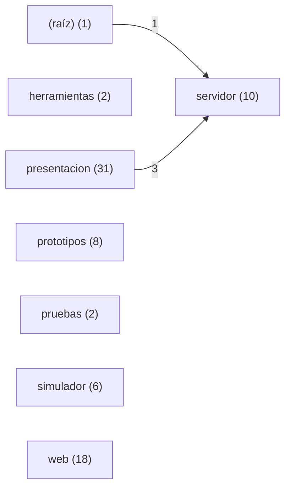

<!-- generado por documentar.py: provisorio, inferido del código. Se regenera con `documentar.py estructura --aplicar`; para editarlo a mano, borrar esta línea. -->

# Módulos y dependencias

Mapa inferido de las importaciones del código; no incluye las dependencias que el análisis no puede ver.

### Dependencias entre módulos

¿Qué módulo usa a qué otro módulo? Cada flecha va del módulo que importa al módulo importado y el número es la cantidad de importaciones. Entre paréntesis, la cantidad de archivos de cada módulo.

